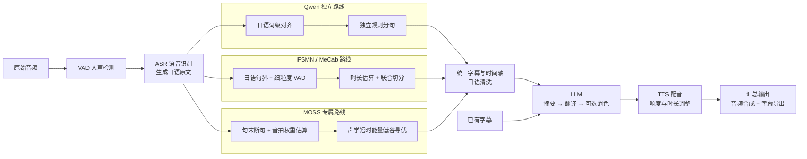

<h1 align="center">ASMRTranslator Backend</h1>

<p align="center"><strong>日文 ASMR → 中文配音</strong></p>
<p align="center">可独立运行、可接入桌面应用的 Python 音频处理后端</p>

<p align="center">
  <a href="https://www.python.org/downloads/"></a>
  <a href="https://docs.astral.sh/uv/"></a>
  <a href="https://ffmpeg.org/"></a>
  <a href="#快速开始"></a>
  <a href="LICENSE"></a>
</p>

<p align="center">
  <a href="#快速开始">快速开始</a> ·
  <a href="#处理流程">处理流程</a> ·
  <a href="#配置与日志">配置与日志</a> ·
  <a href="#开发与打包">开发与打包</a> ·
  <a href="#许可">许可</a>
</p>

---

支持可选字幕、语音识别、LLM 翻译润色、多种 TTS、音频同步、编排与导出。

## 快速开始

> **运行环境**：Windows x64 · Python 3.11 · uv。仓库已随附 Windows 版 FFmpeg、FFprobe 和 VAD 运行资源。

```powershell
uv sync --frozen
uv run python main.py "audio.mp3" "subtitles.vtt" --output "./output/demo"
```

字幕支持 **VTT / SRT / LRC**；省略字幕时需配置 ASR 及翻译服务。外部服务的地址、API Key 和音色由使用者自行提供。

<details>
<summary>查看全部命令行参数</summary>

```powershell
uv run python main.py --help
```

</details>

## 处理流程




## 配置与日志

项目生成的非音频数据统一存储在 SQLite 中，包括字幕、阶段缓存、原始响应、
清洗/对齐审计、编排草稿、音频元数据快照和运行日志。桌面端每个项目共用
`generated/project.sqlite3`，音频位于 `generated/assets/`、`generated/reference-audio/`
及 `generated/artifact/`。独立 CLI 将 `--output` 作为数据库与音频的存储根。
接口返回的 `sqlite:` 引用是数据库文档地址，不是文件路径。
旧版 JSON/VTT/日志文件不再作为内部存储或恢复来源。

用户配置沿用用户目录下的 `.asmrts`，已有环境变量优先。

| 配置项 | 说明 |
| --- | --- |
| 本地日志与过程产物 | 保存在任务输出目录 |
| `ASMR_LOG_UPLOAD_URL` | 远程错误上报地址；源码未配置时默认为空 |
| `ASMR_DISABLE_LOG_UPLOAD=1` | 关闭远程错误上报 |

正式构建可将 Workflow 提供的地址嵌入 EXE，运行时环境变量仍可覆盖。日志上报不需要 token。

## 开发与打包

LLM 通过 `modules/llm/` 独立复用：`runtime.py` 负责请求、重试和缓存，`providers/` 负责服务商协议，`factory.py` 注册能力。每个能力单独放在 `capabilities/capXxx/`：`capSummary` 摘要、`capTranslation` 翻译、`capPolish` 润色及同语言编辑。字幕业务通过 `modules/subtitle_processing/` 调用这些能力并处理时间轴，返回新的字幕块；其他模块也可直接注入、调用所需能力。

**运行测试**

```powershell
uv run python -m unittest discover -s tests
```

**构建后端**（需要 Node.js）

```powershell
uv sync --all-groups --frozen
node scripts/build-nuitka.js
```

产物：`build_staging_elec/resources/main.exe`；桌面项目可通过构建环境变量 `ASMR_SIDECAR_RESOURCE_DIR` 指定产物目录。部署时还需提供 `ffmpeg_bin/` 中的 FFmpeg、FFprobe。

| 位置 | 用途 |
| --- | --- |
| [`main.py`](main.py) | 命令行入口 |
| [`modules/pipeline.py`](modules/pipeline.py) | 流程编排 |
| [`modules/`](modules/) | 各处理阶段的实现 |
| [`tests/`](tests/) | 单元测试与契约验证 |

## 许可

项目原创代码采用 [PolyForm Noncommercial 1.0.0](LICENSE)，仅授权许可规定的非商业用途，禁止未经另行授权的商业使用。修改和再分发须遵守许可条款并保留必要声明。

本项目属于**源码可用（Source Available）**，不属于 OSI 定义的开源软件。第三方代码、模型、字典及 FFmpeg 等资源保留各自许可，详见 [第三方声明](THIRD_PARTY_NOTICES.md)。

[贡献指南](CONTRIBUTING.md) · [安全报告](SECURITY.md)
